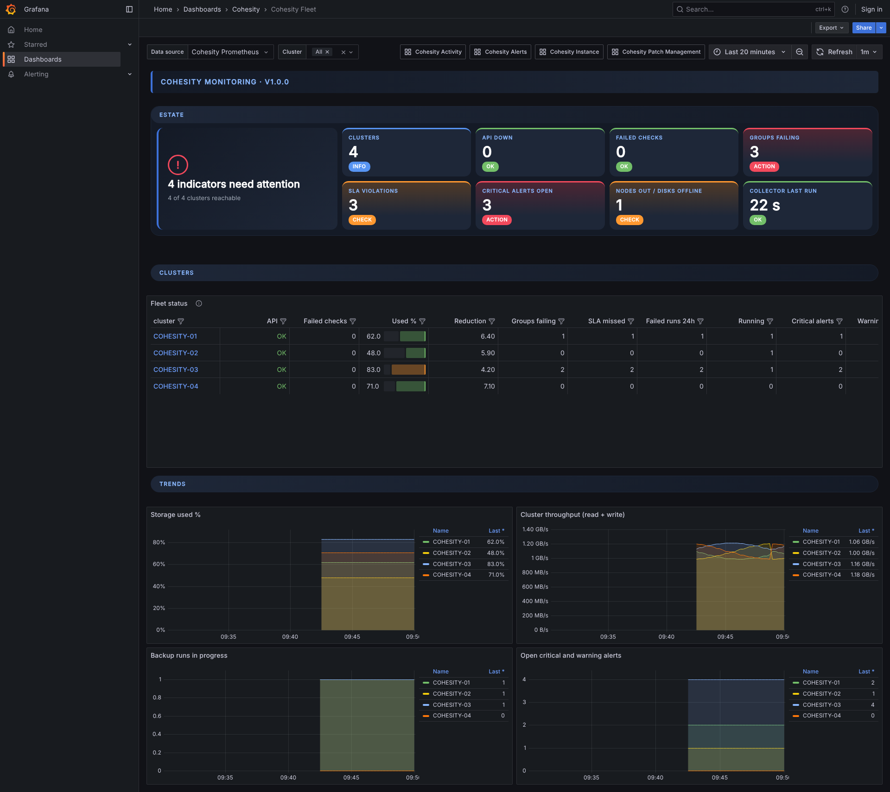
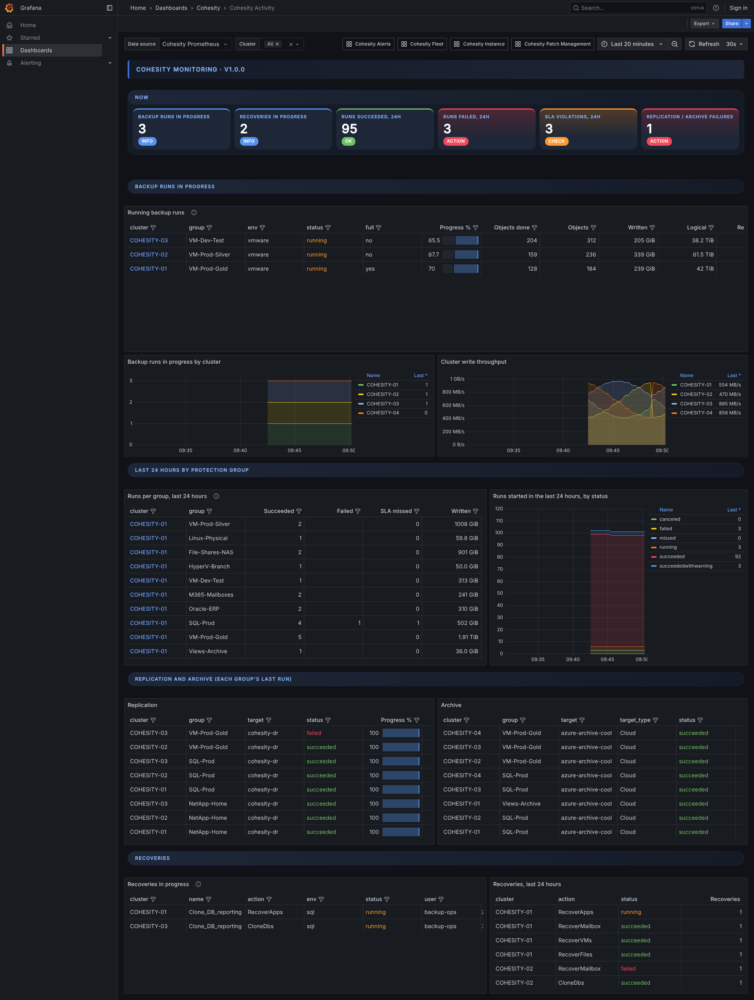
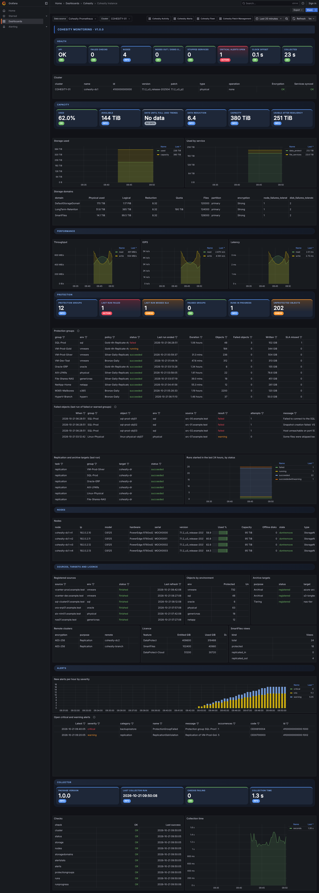
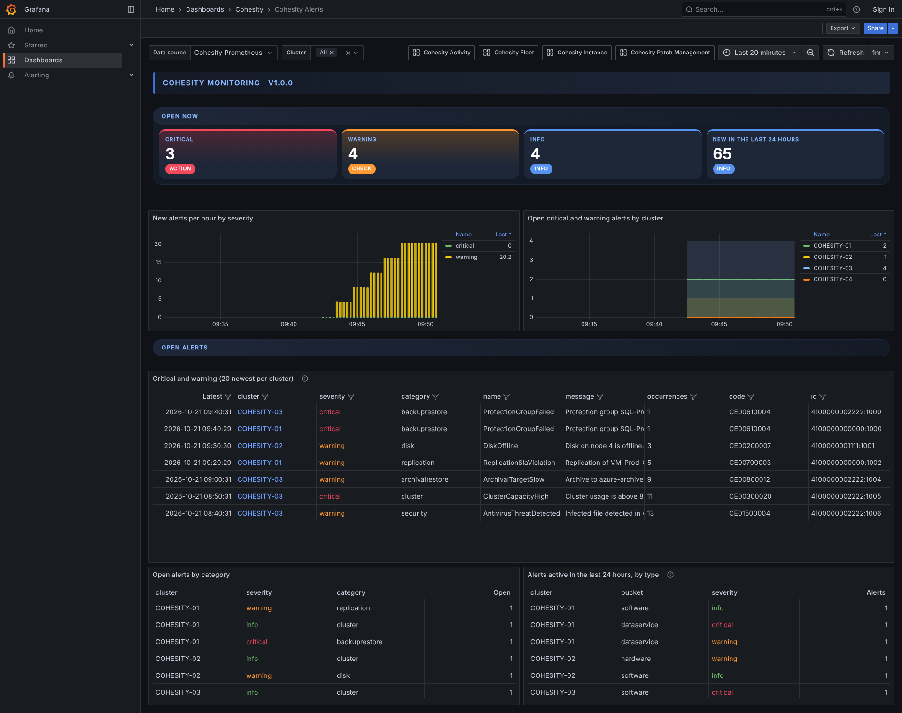
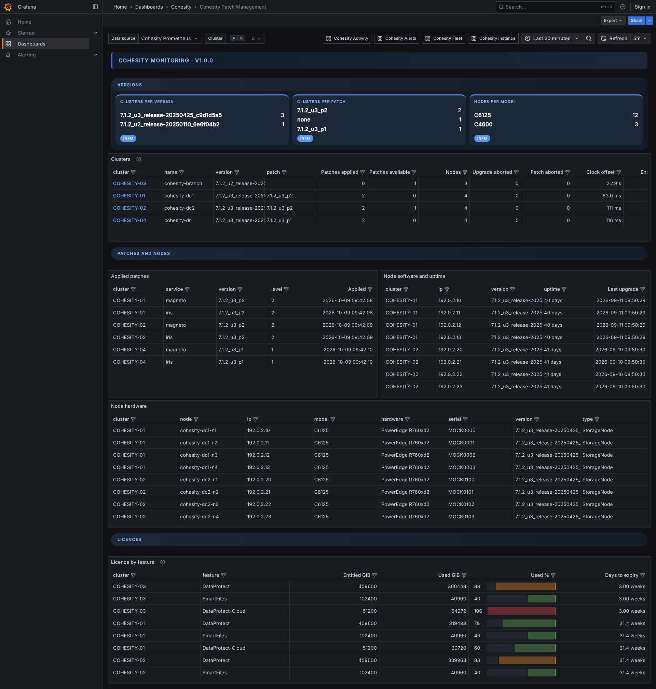

# Cohesity Monitoring

A self-contained package that monitors Cohesity DataProtect clusters using a PowerShell collector, windows_exporter, Prometheus and Grafana, all on one Windows host. The same stack also runs on one Linux host, with node_exporter in place of windows_exporter (see [Install on a Linux machine](#install-on-a-linux-machine)). It talks to the clusters' REST API only (v2 at `/v2`, v1 at `/irisservices/api/v1/public`); nothing is installed on them. Not affiliated with Cohesity. Every Cohesity API call it makes is read-only: GETs, plus, in `AuthMode` `Password`, the access-token login (`POST /irisservices/api/v1/public/accessTokens`), which changes nothing on the cluster. `Cohesity.psm1` has no way to send any other method.

```
Cohesity API --(Export-CohesityMetrics.ps1, every 5 min)--> metrics\cohesity.prom  (metrics/cohesity.prom on Linux)
   --> windows_exporter (Linux: node_exporter) :9182 --> Prometheus 127.0.0.1:9090 --> Grafana :3000 (dashboard + alerts)
```

It is the same layout, installers, control scripts, theme and dashboard style as the StorSafe monitoring package, so the two can run side by side (see [Running next to StorSafe monitoring](#running-next-to-storsafe-monitoring)).

## Screenshots

Rendered from the test kit's mock API (`tools\test`), four made-up clusters with the template names `COHESITY-01` to `COHESITY-04`, with Business Text installed and the default theme. Each dashboard links to the others from its top bar.

**Fleet**: estate health cards, then one row per cluster with API state, failed checks, storage used, data reduction, failing groups, SLA misses, failed runs, open alerts, hardware faults and versions.



**Activity**: backup runs in progress (progress, objects, data written, remaining time), runs per group over the last 24 hours, the last replication and archive of every group, and recoveries.



**Instance**: one cluster (cluster picker, one URL per cluster): health, capacity and storage domains, performance, protection groups and failed objects, nodes, sources, archive targets, remote clusters, licence, alerts and the collector itself.



**Alerts**: open alerts by severity, new alerts per hour, the newest open critical and warning alerts per cluster, and counts by category.



**Patch Management**: software versions and patch levels, applied and available patches, node software, hardware and uptime, and licences.



The first screen of Fleet as a 1080p monitor shows it: [grafana-fleet-1080p.png](docs/images/grafana-fleet-1080p.png).

## Layout

| Path | Contents |
|---|---|
| `VERSION`, `CHANGELOG.md` | Package version and what changed between versions |
| `Install-CohesityMonitoring.ps1` | One-shot installer (idempotent, safe to re-run) |
| `Get-CohesityInstallers.ps1` | Downloads the third-party installers into `installers\` |
| `CohesityMonitoringControl.ps1` | Status / Stop / Start / Pause / Resume of the whole stack, for maintenance |
| `Publish-CohesityDashboards.ps1` | Writes the dashboards Grafana loads, in the site theme (`monitoring\theme.json`) |
| `linux\install.sh` | One-shot Linux installer (idempotent, safe to re-run; `--help` lists its options) |
| `linux\get-installers.sh` | Downloads the four third-party tarballs into `installers\` (`--print-urls` for a host with no internet access) |
| `linux\cohesity-control.sh` | status / stop / start / pause / resume of the whole stack on Linux, for maintenance |
| `linux\systemd\` | Unit and timer templates that `install.sh` renders into `/etc/systemd/system` |
| `linux\lib.sh` | Functions shared by the Linux scripts (not run by itself) |
| `Cohesity.psm1` | Shared API client (read-only by construction) |
| `Cohesity.config.json` | Clusters and settings. **Edit the Servers list before installing.** |
| `Export-CohesityMetrics.ps1` | Metrics collector (run by the scheduled task) |
| `Get-CohesityActivity.ps1`, `Get-CohesityFailedObjects.ps1` | Ad-hoc CSV/console reports |
| `metrics\` | windows_exporter or node_exporter textfile directory (`cohesity.prom`, plus `cohesity-<cluster>.prom` per cluster in parallel mode) |
| `reports\` | CSV output of the Get-* scripts (30-day retention) |
| `creds\` | Credential files (created by the installer): DPAPI-protected on Windows, Export-Clixml files in a mode 0700 folder on Linux |
| `installers\` | Put the third-party installers here (see `installers\README.txt`) |
| `state\` | Collector state: alert bookmark and counters, first-seen times of running runs, cached slower checks (safe to delete) |
| `events\` | Raw alert archive, one CSV per cluster per day (90-day retention) |
| `prometheus\` | Created at install: Prometheus binaries, config and data |
| `grafana\`, `node_exporter\` | Created at install on Linux: the extracted Grafana (with its data) and node_exporter |
| `monitoring\` | prometheus.yml, Grafana provisioning, dashboard JSON, theme example, task registration script |

Paths are written with backslashes, as on Windows; on Linux they are the same names with `/`.

## The Cohesity account

Give the collector its own local Cohesity user with the built-in **Viewer** role (read-only), on every cluster. Two ways to authenticate, per cluster (`AuthMode` in the config):

- **`ApiKey`** (default, recommended): create an API key for that user (Settings > Access Management > API Keys, or the user's own profile in Helios-managed clusters). The collector sends it in the `apiKey` header; there is no login and no session. When the credential prompt appears, enter any user name (e.g. `apikey`) and the API key as the password.
- **`Password`**: the collector logs in with the user name and password (`POST .../accessTokens`, domain `LOCAL` unless `Domain` is set or the user name is `DOMAIN\user` or `user@domain`) and uses the bearer token; it logs in again once if the token expires mid-run. Use this when API keys are not allowed; an Active Directory account works if it has the Viewer role.

The Viewer role sees everything the dashboards need. It cannot change anything, so even a mistake in the package could not alter a cluster. Multi-tenant clusters: the collector asks for `includeTenants=true` where the API offers it, so a cluster-level Viewer sees every organisation's groups.

## Install on a new Windows machine

What you need:

- Windows 10/11 or Windows Server 2016 or later, 64-bit, with Windows PowerShell 5.1 (built in). About 2 GB of disk for the stack plus Prometheus data (roughly 50 MB per cluster per month at the default 180-day retention).
- A local Administrator account for the install, and the account the collector will run as (it can be the same one; the installer asks for its password so the scheduled task runs while logged off).
- Network access from this machine to every cluster on the API port (https 443 by default) and, for the installer download step only, to github.com and grafana.com (or the four installer files copied in by hand).
- For each cluster, an API account. Use a Viewer-role user with an API key; see [The Cohesity account](#the-cohesity-account).

Steps, from an elevated cmd prompt (right-click Command Prompt > Run as administrator), logged on as the account that will run the collector:

1. Extract the release zip and copy the `CohesityMonitoring` folder to a path **without spaces**, e.g. `C:\CohesityMonitoring` (or, with git on the machine, `git clone https://github.com/triippiing/cohesity-monitoring.git C:\CohesityMonitoring`; the checkout is the package). The windows_exporter MSI can't handle spaces in the metrics path, so the installer refuses to run from such a folder.
2. Get the third-party installers into `installers\`:
   ```
   powershell.exe -NoProfile -ExecutionPolicy Bypass -File C:\CohesityMonitoring\Get-CohesityInstallers.ps1
   ```
   (add `-Proxy http://proxy:port` if the machine needs one; with no internet access, download the four URLs it prints on another machine and copy the files in). The fourth file is Grafana's Business Text panel plugin, which draws the card sections (rounded value blocks on a navy panel); without it each section shows a row of Grafana stat panels instead.
3. Copy `Cohesity.config.example.json` to `Cohesity.config.json` (the installer does this for you if the file is missing, then stops so you can edit it) and fill in the `Servers` list: a name, IP or hostname, and credential file name per cluster. Under `Defaults`, check `Scheme` and `SkipCertificateCheck` (true for self-signed cluster certificates). The example shows every setting; the real file is ignored by git.
4. Run the installer:
   ```
   powershell.exe -NoProfile -ExecutionPolicy Bypass -File C:\CohesityMonitoring\Install-CohesityMonitoring.ps1
   ```
   It prompts for each cluster's API account, then for the collector account's Windows password. It then installs windows_exporter, Prometheus (as a startup task), Grafana (with the data source and dashboards provisioned) and the collector task, runs the collector once, and prints a summary table. Every step is idempotent: if a step reports a missing installer, add the file and re-run.
5. Check it:
   ```
   powershell.exe -NoProfile -ExecutionPolicy Bypass -File C:\CohesityMonitoring\CohesityMonitoringControl.ps1 Status
   ```
   All four components should show Running/Ready and answering. Then open http://localhost:3000 (first login admin/admin, you are asked to change it) and go to **Dashboards > Cohesity**:

- **Cohesity Fleet**: estate cards, then one row per cluster (API up, failed checks, storage used, data reduction, failing groups, SLA misses, failed runs, open alerts, node and disk faults, version), red rows at the top. Click a cluster name to open its Instance page.
- **Cohesity Activity**: backup runs in progress (group, environment, progress, objects, written, remaining, start), runs per group in the last 24 hours, the last replication and archive of every group, and recoveries.
- **Cohesity Instance**: everything for one cluster, chosen from the Cluster picker (health, capacity and storage domains, performance, protection groups and failed objects, nodes, sources, targets, licence, alerts, collector). Each cluster has its own URL: `/d/cohesity-instance?var-cluster=NAME`.
- **Cohesity Patch Management**: software version and patch level per cluster, applied and available patches, node software, uptime and hardware, licences.
- **Cohesity Alerts**: open critical, warning and info alerts across the estate, new alerts over time and a filterable table of the newest ones.

The dashboards are file-provisioned from `monitoring\dashboards-live\`, which `Publish-CohesityDashboards.ps1` writes from the package's `monitoring\dashboards\` (the installer runs it). Deleting a JSON file from `monitoring\dashboards\` and re-running the publish script removes that dashboard from Grafana.

### Theme and branding

Every dashboard opens with a banner (logo, brand line and the installed package version), each section is headed by a full-width rounded pill, and with the Business Text plugin installed every row of value blocks (Fleet's Estate, Instance's Health, Capacity, Protection and Collector, Activity's Now, the Alerts counts and the Patch Management versions) is a card section: the header pill with a navy panel under it holding one rounded card per value, coloured by the same thresholds and value mappings as the stat panels it replaces. Fleet's Estate also has a health summary. Tables and charts are Grafana's own panels and keep Grafana's look; Grafana gives a dashboard no way to restyle them. The colours, the brand line and a logo come from a theme file that stays on the monitoring host:

1. Copy `monitoring\theme.example.json` to `monitoring\theme.json` (ignored by git and left out of the release packages) and set `brand`, the colours (`#RRGGBB`) and optionally `logo`, an SVG or PNG for a dark background (up to 512 KB), with a path relative to the theme file, e.g. `theme\logo.svg` in `monitoring\theme\`.
2. Publish:
   ```
   powershell.exe -NoProfile -ExecutionPolicy Bypass -File C:\CohesityMonitoring\Publish-CohesityDashboards.ps1 -HtmlPanels
   ```
   (leave out `-HtmlPanels` if the plugin is not installed). Grafana loads the result within a minute; nothing needs restarting.

`ok`, `warning`, `critical` and `info` replace Grafana's green, orange, red and blue in every threshold and value mapping; `background`, `surface`, `accent`, `label` and `muted` colour the banner and cards. Without a `theme.json` the dashboards keep Grafana's own colours. On Linux the same command runs under `pwsh` (`sudo pwsh -NoProfile -File /opt/cohesity-monitoring/Publish-CohesityDashboards.ps1 -HtmlPanels`), or re-run `linux/install.sh`, which publishes as part of its Grafana step.

Ports: Grafana 3000 (all interfaces; put it behind the Windows firewall or bind it to 127.0.0.1 in Grafana's `conf\custom.ini` if only local use is wanted), Prometheus 9090 and windows_exporter 9182 (127.0.0.1 only, nothing to open). Everything restarts by itself after a reboot.

Adding an cluster later: add it to `Servers` in the config, then create its credential file as the collector account:

```
powershell.exe -NoProfile -ExecutionPolicy Bypass -Command "Import-Module C:\CohesityMonitoring\Cohesity.psm1; New-CohesityCredentialFile -Path C:\CohesityMonitoring\creds\NEWNAME.xml"
```

The next collector run picks it up; the Fleet, Activity and Patch pages show it automatically and it appears in the Instance page's cluster picker.

## Install on a Linux machine

The same package on one Linux host: the collector runs under PowerShell 7 from a systemd timer, node_exporter serves the textfile metrics, and Prometheus and Grafana run as systemd services, all out of the install folder. The collector, the metrics and the dashboards are the same as on Windows.

What you need:

- 64-bit (x86_64) Linux with systemd: RHEL family 8 or 9 (RHEL, Rocky Linux, AlmaLinux), Debian 12, or an Ubuntu LTS release. About 2 GB of disk for the stack plus Prometheus data (roughly 50 MB per cluster per month at the default 180-day retention).
- Root through sudo. The installer creates a system account, `cohesity`, and the collector and every service run as it, so unlike the Windows install you do not log on as the collector account.
- `curl`, `tar` and `gzip` (the installer checks for them), and the ICU library that PowerShell needs if the host does not have it yet: `dnf install libicu` on the RHEL family, `apt-get install libicu72` on Debian 12, `apt-get install libicu74` on Ubuntu 24.04 (other Debian-family releases: `apt-cache search --names-only '^libicu[0-9]+$'` finds the package name). The installer stops with this hint when `pwsh` does not start.
- PowerShell 7: the installer uses a `pwsh` that is already on the PATH, otherwise it unpacks the PowerShell tarball (7.6.6, the LTS line; PowerShell 7.4 reaches end of support on 2026-11-10).
- Network access from this machine to every cluster on the API port (https 443 by default) and, for the download step only, to github.com, dl.grafana.com and grafana.com (or the four tarballs and the plugin zip copied in by hand).
- For each cluster, an API account. Use a Viewer-role user with an API key; see [The Cohesity account](#the-cohesity-account).

Steps, from a shell on the host. Commands that need root start with `sudo`; the ones after step 1 run from the install folder (`cd /opt/cohesity-monitoring`):

1. Put the package in `/opt/cohesity-monitoring`, a path **without spaces** (the installer refuses one). With git on the machine, the clone is the package:
   ```
   sudo git clone https://github.com/triippiing/cohesity-monitoring.git /opt/cohesity-monitoring
   ```
   Otherwise extract the release tarball; it unpacks into a `CohesityMonitoring` folder, hence `--strip-components=1`:
   ```
   sudo mkdir -p /opt/cohesity-monitoring
   sudo tar -xzf Cohesity-monitoring-v<ver>.tar.gz --strip-components=1 -C /opt/cohesity-monitoring
   ```
   The scripts are executable in the clone and in the tarball. To install somewhere else, give `--root DIR` to every installer run (this section assumes the default).
2. Get the third-party tarballs into `installers/`:
   ```
   sudo linux/get-installers.sh
   ```
   It downloads node_exporter 1.12.1, Prometheus 3.15.0, Grafana 12.0.2, PowerShell 7.6.6 and the Business Text panel plugin 6.2.0 (the card sections; optional), and keeps files that are already there (`--force` downloads again, `--dest DIR` picks another folder, `--node-exporter-version`, `--prometheus-version`, `--grafana-version`, `--powershell-version` and `--business-text-version` pick other versions). curl takes its proxy from the environment, and sudo drops that, so with a proxy run `sudo env https_proxy=http://proxy:port linux/get-installers.sh`. With no internet access, `linux/get-installers.sh --print-urls` prints the five URLs: download them on another machine and copy the files into `installers/`.
3. Create `Cohesity.config.json` from `Cohesity.config.example.json` (the installer does this for you if the file is missing, then stops so you can edit it) and fill in the `Servers` list as in step 3 of the Windows install: a name, IP or hostname, and credential file name per cluster, and under `Defaults` the `Scheme` and `SkipCertificateCheck` settings. The example's `creds\cohesity-01.xml` paths work on Linux as written (`creds/cohesity-01.xml` is the same file).
   ```
   sudo cp Cohesity.config.example.json Cohesity.config.json
   ```
   Then edit the new file as root: `sudoedit Cohesity.config.json` (or `sudo nano Cohesity.config.json`).
4. Run the installer:
   ```
   sudo linux/install.sh
   ```
   It installs PowerShell if `pwsh` is missing, creates the `cohesity` service account, makes the package readable by it, prompts for each cluster's API account that has no credential file yet, runs the collector once as a test, then installs node_exporter, Prometheus and Grafana (with the data source and dashboards provisioned), the systemd units and the collector timer, and prints a summary table (OK, Skipped, Missing installer or Check per step) and what to do next. Every step is idempotent: if a step reports a missing installer or a check, fix it and re-run. The exit status is 0 when no row is Check or Missing installer.
5. Check it:
   ```
   linux/cohesity-control.sh status
   ```
   The collector timer should be active with a next run, and node_exporter, Prometheus and Grafana should show "answering on" their ports (the collector service itself only runs for the length of one collection, so it normally shows inactive between runs). Then look at the three pages:
   - http://127.0.0.1:9182/metrics (node_exporter): the `cohesity_` series are in the list.
   - http://127.0.0.1:9090/targets (Prometheus): job `cohesity` is UP.
   - http://127.0.0.1:3000 (Grafana; from another machine use the host's name instead of 127.0.0.1): first login admin/admin, you are asked to change it. Then go to **Dashboards > Cohesity**: the five dashboards are the ones described under the Windows steps above.

The installer's steps:

| # | Step | What it does |
|---|---|---|
| 1 | Preconditions | Checks root, systemd, x86_64, curl, tar and gzip, and that the install folder holds the package; notes a port (9182, 9090, 3000) that something else already listens on |
| 2 | PowerShell | Uses the `pwsh` on the PATH, else unpacks the PowerShell tarball to `/opt/microsoft/powershell/7` and links `/usr/bin/pwsh`; stops with the ICU hint if `pwsh` does not start |
| 3 | Service user | Creates the `cohesity` system account (no login shell, the install folder as its home) and the folders it writes to: `creds/`, `state/`, `events/`, `metrics/`, `reports/` |
| 4 | Config | Creates `Cohesity.config.json` from the example if it is missing, then stops so you can edit it |
| 5 | Package permissions | Adds read permission for everyone over the install folder (`creds/` and the data folders excepted, nothing is ever taken away), so `cohesity` can read the package whatever root's umask was when it was unpacked; stops if a folder above the install folder still blocks it |
| 6 | Credentials | Prompts for each missing credential file and saves it as `cohesity` (see below) |
| 7 | Collector test | Runs the collector once as `cohesity` and reports the result |
| 8 | node_exporter, Prometheus, Grafana | Unpacks the newest tarball of each from `installers/` into `node_exporter/`, `prometheus/` and `grafana/` (a newer tarball there is an upgrade; `data/` is kept; the files stay root-owned, only `data/` belongs to `cohesity`), puts `monitoring/prometheus.yml` and the Grafana data source and dashboard provisioning in place, unpacks the Business Text plugin zip into `grafana/data/plugins/` when there is one, and publishes the dashboards to `monitoring/dashboards-live/` |
| 9 | Units and services | Renders the unit files from `linux/systemd/` into `/etc/systemd/system`, enables and starts them (starting the collector's timer runs the collector straight away, then every 5 minutes or your `--interval-minutes`), restarts what changed, and waits for the three ports to answer; a unit whose component reported Missing installer or Check is left disabled and named in the Services row |

Switches (`linux/install.sh --help` lists them). Give the same ones again when you re-run the installer, because the unit files are rendered from them:
- `--root DIR`: the install folder, the folder that holds this package (default `/opt/cohesity-monitoring`, no spaces).
- `--user NAME`: the account that runs the collector and the services (default `cohesity`, created if missing).
- `--interval-minutes N` (1 to 60, default 5) and `--retention-days N` (1 to 3650, default 180).
- `--collector-only` and `--listen ADDR:PORT`: see the next paragraph.
- `--skip-credentials` if the credential files are already in place or will be made later.
- `--no-services` writes the files and prints the `systemctl` commands it would run, without needing systemd (for images and containers); `--unit-dir DIR` writes the unit files to another folder (default `/etc/systemd/system`).
- `--uninstall`: see Uninstall below.

**Collector only.** For a host that sends its metrics to a Prometheus and Grafana you already run elsewhere, add `--collector-only`. The installer then sets up PowerShell, the collector and node_exporter only, so it needs the node_exporter tarball (and the PowerShell one unless `pwsh` is installed already) but not Prometheus or Grafana:

```
sudo linux/install.sh --collector-only
```

node_exporter then listens on `0.0.0.0:9182` (`--listen ADDR:PORT` changes that) so that the Prometheus server can reach it. Allow port 9182 from that server in the host firewall:

```
sudo firewall-cmd --permanent --add-port=9182/tcp && sudo firewall-cmd --reload     # RHEL family
sudo ufw allow 9182/tcp                                                              # Debian, Ubuntu
```

Add this job to `scrape_configs` in that Prometheus's `prometheus.yml` and reload it (the installer prints it with this host's name when it finishes):

```yaml
  - job_name: cohesity
    static_configs:
      - targets: ['<this host>:9182']
    metric_relabel_configs:
      - source_labels: [__name__]
        regex: 'cohesity_.*|windows_textfile_.*|node_textfile_.*'
        action: keep
```

The `keep` rule is the one in `monitoring/prometheus.yml`: it keeps the Cohesity series and the textfile collector's own health metrics and nothing else from the host. Import the five dashboards, `monitoring/dashboards/*.json` (or, for the site theme, the files `Publish-CohesityDashboards.ps1` writes to `monitoring/dashboards-live/`), into that Grafana (Dashboards > New > Import) and choose your Prometheus in each dashboard's Data source box (they open on a data source with the uid `cohesity-prometheus`, which is the one the full-stack install provisions).

**Credentials on Linux.** There is no DPAPI on Linux: `New-CohesityCredentialFile` saves the credential with Export-Clixml and the file is **not encrypted**. What protects it is file permissions: `creds/` is mode 0700 and each credential file 0600, owned by the service account `cohesity`, so only that account and root can read them. The installer prompts for each missing file (as `cohesity`; a file that several clusters share is asked for once) unless you pass `--skip-credentials`. Unlike a DPAPI file, one of these works on any machine it is copied to, so keep `creds/` out of backups that others can read.

Ports: Grafana 3000 (all interfaces; to reach it from other machines open the port in the host firewall, `sudo firewall-cmd --permanent --add-port=3000/tcp && sudo firewall-cmd --reload` or `sudo ufw allow 3000/tcp`), Prometheus 9090 and node_exporter 9182 (127.0.0.1 only, nothing to open; with `--collector-only` node_exporter is on all interfaces, as above). Everything restarts by itself after a reboot: the units are enabled, and the collector runs again shortly after boot.

**SELinux.** On a RHEL family host in enforcing mode this package needs no policy module: the binaries under `/opt` carry the `usr_t` file context and systemd runs them in the `unconfined_service_t` domain. A site with a stricter policy sees denials in `sudo ausearch -m AVC -ts recent` (add `-c pwsh`, `-c grafana`, `-c prometheus` or `-c node_exporter` to look at one program) and in the units' `journalctl`. That check is part of the maintainer's acceptance test on a RHEL host, not of CI.

Adding an cluster later: add it to `Servers` in the config, then re-run `sudo linux/install.sh` with your usual switches. It asks only for the credential files that are missing, and the next collector run picks the cluster up; the dashboards show it automatically.

## Upgrading an existing install

Read `CHANGELOG.md` for what changed, then copy the new files over the install folder, keeping your `Cohesity.config.json` and `creds\`. From an elevated cmd prompt, with the new zip extracted to `C:\Temp\CohesityMonitoring`:

```
robocopy C:\Temp\CohesityMonitoring C:\CohesityMonitoring /E /XF Cohesity.config.json /XD creds
```

Upgrading from v4.x: the Estate and Detail dashboards are replaced by the five above, so delete their JSON files and Grafana drops them within a minute:

```
del C:\CohesityMonitoring\monitoring\dashboards\cohesity-estate.json C:\CohesityMonitoring\monitoring\dashboards\cohesity-detail.json
```

Nothing needs restarting. The next collector run picks up the new checks (run it by hand to see the output straight away), and Grafana loads the new dashboard within a minute.

Upgrading from 5.1 or earlier: Grafana now loads the dashboards from `monitoring\dashboards-live\` (see [Theme and branding](#theme-and-branding)). Get the plugin with `Get-CohesityInstallers.ps1`, then re-run the installer once so that it installs the plugin, publishes the dashboards and points Grafana at the new folder; the switches leave the other components alone:

```
powershell.exe -NoProfile -ExecutionPolicy Bypass -File C:\CohesityMonitoring\Install-CohesityMonitoring.ps1 -SkipCredentials -SkipExporter -SkipPrometheus -SkipCollectorTask
```

**On Linux**, read `CHANGELOG.md` the same way, then unpack the new tarball over the install folder, keeping your config and credentials (the two `--exclude` options leave `Cohesity.config.json` and `creds/` alone, and `--no-overwrite-dir` keeps the owner and mode of the folders that already exist, such as `creds/` and `state/`, which belong to `cohesity`):

```
sudo tar -xzf Cohesity-monitoring-v<ver>.tar.gz --strip-components=1 --no-overwrite-dir -C /opt/cohesity-monitoring --exclude=Cohesity.config.json --exclude='creds/*'
```

or, for a git clone, `sudo git -C /opt/cohesity-monitoring pull`. Then re-run the installer with the same switches you installed with:

```
sudo /opt/cohesity-monitoring/linux/install.sh
```

It rewrites a unit file or a config only when it changed and restarts only the services that changed. A newer node_exporter, Prometheus or Grafana tarball in `installers/` is an upgrade too (`linux/get-installers.sh` with `--prometheus-version` and the like fetches one; Prometheus's and Grafana's `data/` are kept). Grafana loads new dashboards within a minute, and the next collector run picks up new checks.

## What the collector reads

Each check is independent: a failure shows as `cohesity_check_success{check="..."} 0` and the rest carry on.

| Cadence | Check | API |
|---|---|---|
| Every run (5 min) | cluster | v1 `cluster?fetchStats=true`: identity, version, capacity, usage, throughput, IOPS, latency, data reduction, clock |
| | status | v1 `cluster/status`: stopped services, services in sync, cluster operation, node status |
| | storage | v2 `stats/cluster-storage` |
| | nodes | v2 `clusters/nodes?fetchStats=true` |
| | storagedomains | v2 `storage-domains?includeStats=true` |
| | alertstats, alerts | v1 `stats/alerts`; v1 `alerts` (open alerts, and new ones since the last run, archived to `events\`) |
| | protectiongroups | v2 `data-protect/protection-groups?includeLastRunInfo=true` (paged): last backup, replication and archive run of every group |
| | runs, runprogress | v2 `data-protect/runs/summary` (last 24 h); v2 `data-protect/runs/{id}/progress` for running runs (up to 50) |
| | sla | v1 `stats/protectionRuns/lastRun` |
| | failedobjects | v2 `protection-groups/{id}/runs?numRuns=1&includeObjectDetails=true`, only for groups whose last run failed or warned (up to 20 groups, 200 objects) |
| | recoveries | v2 `data-protect/recoveries` (last 24 h) |
| Every 15 min | protectionsummary, sources, externaltargets, vaultstats, views, antivirus | v1 `stats/protectionSummary`; v2 `sources/registrations`; v2 `external-targets`; v1 `stats/vaults`; v2 `file-services/views-summary`; v2 `antivirus-service/infected-files` |
| Every 60 min | policies, remoteclusters, consumers, license, patches | v2 `policies`; v2 `remote-clusters`; v1 `stats/consumers`; v1 `licenseUsage`; v2 `patch-management/applied-patches` and `available-patches` |

The 15- and 60-minute checks are cached in `state\` and re-published on the runs in between. `-Refresh` ignores the cache. Timestamps from the API are microseconds (`*Usecs`) and are published as Unix seconds; the v1 I/O counters cover the last 30 seconds and are divided by 30.

**Parallel collection.** With more than two clusters the collector runs one child process per cluster, up to `-MaxParallel` at a time (default: one worker per four clusters, at most 8). Each cluster then writes its own `metrics\cohesity-<cluster>.prom` and `cohesity.prom` carries only the collector summary. `-MaxParallel 1` forces one process.

Optional settings in `Cohesity.config.json` (per cluster, or under `Defaults`):

| Setting | Default | Meaning |
|---|---|---|
| `AuthMode` | `ApiKey` | `ApiKey` or `Password` (see [The Cohesity account](#the-cohesity-account)) |
| `Domain` | `LOCAL` | Login domain in `Password` mode |
| `Scheme`, `Port`, `SkipCertificateCheck`, `TimeoutSec` | `https`, 0 (default port), `false`, 60 | Transport; `SkipCertificateCheck` for self-signed cluster certificates |
| `DisabledChecks` | `[]` | Checks to skip, e.g. `["antivirus", "views"]` for features you don't use |
| `CollectAlerts` | `true` | Read open and new alerts every run |
| `AlertLogDirectory` | `events` | Where the raw daily alert CSVs go |
| `AlertLogRetentionDays` | `90` | Older CSVs are deleted |
| `StateDirectory` | `state` | Collector state |

Not collected on purpose: anything with credentials (`includeSourceCredentials` and `includeEncryptedCredentials` are never requested), encryption keys and KMS settings, API keys, user and role lists, audit logs, and every call that starts work on the cluster (refreshes, tests, downloads). Hardware sensors are not in the API; use IPMI/iDRAC or SNMP for those.

The installer steps are:

| # | Step | What it does |
|---|---|---|
| 1 | Credentials | Creates `creds\<cluster>.xml` for each cluster (the API key, or user and password), readable only by this user on this machine, and restricts the folder ACL |
| 2 | Collector test | Runs the collector once and reports the result |
| 3 | windows_exporter | Silent MSI install with the textfile collector pointed at `metrics\` |
| 4 | Prometheus | Extracts to `prometheus\` and runs at startup as SYSTEM (scheduled task "Cohesity Prometheus"). Listens on localhost only, 180-day retention |
| 5 | Grafana | Silent MSI install, plus a provisioned data source ("Cohesity Prometheus") and dashboards; unpacks the Business Text plugin zip into `<GrafanaHome>\data\plugins` when it is in `installers\` and publishes the dashboards (with `-HtmlPanels` when the plugin is there) |
| 6 | Collector task | Scheduled task "Cohesity Metrics Collector", every 5 minutes |

Switches:
- `-SkipExporter`, `-SkipPrometheus` or `-SkipGrafana` if the host already runs that component (see [Running next to StorSafe monitoring](#running-next-to-storsafe-monitoring)).
- `-IntervalMinutes`, `-PrometheusRetentionDays`.
- `-RunAsUser DOMAIN\svc-account` to run the task as a different account. If you use it, create the credential files while logged on as that account.

## Running next to StorSafe monitoring

Both packages use the same ports (windows_exporter/node_exporter 9182, Prometheus 9090, Grafana 3000), so on one host install one of them in full and the other collector-only:

1. Install StorSafe monitoring as usual (or keep the existing install).
2. Install this package with `-SkipExporter -SkipPrometheus -SkipGrafana` (Linux: `--collector-only`), and set `TextfileDirectory` in `Cohesity.config.json` to StorSafe's `metrics` folder, so the one exporter serves both `storsafe.prom` and `cohesity.prom`.
3. In StorSafe's `monitoring\prometheus.yml`, extend the `metric_relabel_configs` keep regex with `|cohesity_.*`, and restart Prometheus.
4. Add this package's data source and dashboards to the existing Grafana: copy `monitoring\grafana\cohesity-datasource.yaml` and `cohesity-dashboards.yaml` into Grafana's provisioning folders (point the latter at this package's `monitoring\dashboards-live`), run `Publish-CohesityDashboards.ps1 -HtmlPanels`, and restart Grafana once.

Prometheus memory and disk grow with series count; a cluster typically adds 1,500 to 3,000 series, about the same as a StorSafe cluster.

## Day-to-day

```powershell
.\Get-CohesityActivity.ps1                 # interactive: menu + prompts
.\Get-CohesityActivity.ps1 -All -NonInteractive -Hours 12 -IncludeAllRuns
.\Get-CohesityFailedObjects.ps1 -Server COHESITY-01 -IncludeWarnings
.\Export-CohesityMetrics.ps1 -All -NonInteractive   # manual collector run (-MaxParallel 1 to force one process)
(Get-ScheduledTaskInfo 'Cohesity Metrics Collector').LastTaskResult   # 0 OK, 2 a check failed
```

Exit codes for all scripts: 0 OK/idle, 1 informational (runs active, failed objects found), 2 attention or API error, 3 usage/config error.

A check for a feature you don't use (e.g. `antivirus` on a cluster without the antivirus service) shows as `cohesity_check_success{check="antivirus"} 0`. Add it to `DisabledChecks` in the config to stop it running.

## Stopping and starting for maintenance

`CohesityMonitoringControl.ps1` drives the four components (collector task, Prometheus task, windows_exporter service, Grafana service). From an elevated cmd prompt:

| Situation | Command |
|---|---|
| See what is running | `powershell.exe -NoProfile -ExecutionPolicy Bypass -File C:\CohesityMonitoring\CohesityMonitoringControl.ps1 Status` |
| Host maintenance (patching, disk work): stop everything cleanly | `... CohesityMonitoringControl.ps1 Stop` |
| Afterwards | `... CohesityMonitoringControl.ps1 Start` |
| An cluster is being patched or rebooted: stop polling so it logs no failed checks or logins | `... CohesityMonitoringControl.ps1 Pause` |
| Cluster back | `... CohesityMonitoringControl.ps1 Resume` |

Notes:

- `Stop` disables the collector task, stops Prometheus (its scheduled task), then Grafana and windows_exporter. Nothing restarts until `Start`, not even after a reboot, so a stopped host can't come back half-running. `Start` reverses it and runs the collector once.
- A plain reboot without `Stop` is fine too: the services are Automatic, Prometheus starts at boot, and the collector task resumes its 5-minute schedule. Prometheus replays its write-ahead log at start, which can take a minute or two.
- `Pause` only disables the collector task. Prometheus and Grafana keep running, the dashboards keep the last collected values, and the Instance page's collector row shows how old they are. To pause just one cluster of many, remove it from `Servers` in the config instead (and put it back afterwards); the collector reads the config every run.
- If you have set up the "Collector stopped" alert from the table below, expect it to fire while paused or stopped; silence it in Grafana (Alerting > Silences) for the maintenance window.
- The same things by hand: tasks `Cohesity Metrics Collector` and `Cohesity Prometheus` in Task Scheduler (`schtasks /Change /TN "Cohesity Metrics Collector" /DISABLE`), services `windows_exporter` and `Grafana` (`net stop Grafana`).
- Full backup of the monitoring host's state is the install folder plus Grafana's data (`%ProgramFiles%\GrafanaLabs\grafana\data`, for users and any alert rules you add). `creds\` only works on this machine for this user, so a restore elsewhere means re-running the installer's credential step.

**On Linux**, `linux/cohesity-control.sh` drives the five units: the collector timer and the collector service it starts, and the node_exporter, Prometheus and Grafana services. From the install folder (`status` needs no root, the others run with sudo):

| Situation | Command |
|---|---|
| See what is running | `linux/cohesity-control.sh status` |
| Host maintenance (patching, disk work): stop everything cleanly | `sudo linux/cohesity-control.sh stop` |
| Afterwards | `sudo linux/cohesity-control.sh start` |
| An cluster is being patched or rebooted: stop polling so it logs no failed checks or logins | `sudo linux/cohesity-control.sh pause` |
| Cluster back | `sudo linux/cohesity-control.sh resume` |

Notes:

- `stop` stops the collector timer, then node_exporter, Prometheus and Grafana; `start` brings them back in the other order and the collector runs once. Unlike on Windows the units stay enabled, so after a reboot they start again by themselves, also after `stop` and `pause`.
- `pause` only stops the collector timer (a run already in progress finishes); `resume` starts it and runs the collector once. Use these, not `systemctl stop cohesity-collector.service`: that service is a oneshot that runs only for the length of one collection, started by the timer, so stopping it pauses nothing. Prometheus and Grafana keep running and the dashboards keep the last collected values.
- The collector's output is in the journal: `journalctl -u cohesity-collector` (the other units are `cohesity-node-exporter`, `cohesity-prometheus` and `cohesity-grafana`). To run it once by hand: `sudo systemctl start cohesity-collector`.
- A plain reboot without `stop` is fine: the units start by themselves and the collector runs again shortly after boot, then on its schedule. The "Collector stopped" alert from the table below fires on Linux too while the collector is paused or stopped.
- Full backup of the monitoring host's state is the install folder: the config, `creds/`, and the Prometheus and Grafana data in `prometheus/data` and `grafana/data`. `creds/` holds the API passwords unencrypted, so protect the backup like a secret.

A re-run of `install.sh` re-renders the unit files, so a hand edit to one of them is lost. Site settings go in a drop-in instead (`sudo systemctl edit cohesity-collector.service`); the usual one is a corporate proxy, which the collector honours on Linux. The clusters are normally on-site, hence `no_proxy`:

```
[Service]
Environment=https_proxy=http://proxy.example.com:3128
Environment=no_proxy=127.0.0.1,localhost,.example.com
```

## Versioning

`VERSION` holds the package version (also printed by the installer and published as `cohesity_collector_info{version="..."}`, shown on the Instance dashboard's Collector row), and `CHANGELOG.md` lists what changed. Keep the extracted release zips; an upgrade is always "copy the new release over the install folder" as above, so the previous zip is the rollback. On Linux the release tarball plays the same part.

## Alert rules (Grafana > Alerting > Alert rules > New, data source "Cohesity Prometheus")

| Alert | Query | For | Severity |
|---|---|---|---|
| Cluster API down | `cohesity_up == 0` | 10m | Critical |
| Collector stopped | `time() - cohesity_collector_last_run_timestamp_seconds > 900` | 5m | Critical |
| Protection group last run failed | `cohesity_group_last_run_ok == 0` | 5m | Major |
| SLA missed | `cohesity_group_last_run_sla_violated == 1` | 5m | Warning |
| Replication or archive failed | `cohesity_replication_last_status{status=~"failed\|canceled"} == 1 or cohesity_archive_last_status{status=~"failed\|canceled"} == 1` | 15m | Major |
| Group not backed up in 26 h | `time() - cohesity_group_last_run_end_timestamp_seconds > 93600 and on(cluster, group) cohesity_group_paused == 0` | 30m | Warning |
| Critical alert open | `cohesity_alerts_open{severity="critical"} > 0` | 5m | Critical |
| Storage over 80 % | `100 * cohesity_storage_used_bytes / cohesity_storage_capacity_bytes > 80` | 30m | Warning |
| Node out or disk offline | `cohesity_node_in_cluster == 0 or cohesity_node_offline_disks > 0` | 15m | Major |
| Cluster service stopped | `cohesity_cluster_stopped_services > 0` | 15m | Major |
| Source refresh failing | `cohesity_source_status{status="failed"} == 1` | 1h | Warning |
| Infected files found | `cohesity_av_infected_files_found > 0` | 15m | Major |
| Licence expires within 30 days | `cohesity_license_expiry_timestamp_seconds - time() < 30 * 86400` | 1h | Warning |
| Clock offset | `abs(cohesity_time_offset_seconds) > 60` | 30m | Warning |
| Collector check failing | `cohesity_check_success == 0` | 30m | Warning |

Add a contact point (email or Teams webhook) under Alerting > Contact points. The cluster raises its own alerts too; the "Critical alert open" rule forwards them, and Cohesity's own SMTP/SNMP alerting is unaffected.

## Metrics reference

Every series carries `cluster` (the `Name` from the config). Info metrics have the value 1 unless noted; `status` labels are lower-case API values (`succeeded`, `succeededwithwarning`, `failed`, `running`, ...), environment labels drop Cohesity's `k` prefix (`kVMware` becomes `vmware`).

| Metric | Labels |
|---|---|
| `cohesity_up`, `cohesity_collect_duration_seconds` | cluster |
| `cohesity_check_success`, `cohesity_check_last_success_timestamp_seconds` | cluster, check |
| `cohesity_collector_info`, `cohesity_collector_last_run_timestamp_seconds`, `cohesity_collector_*` | version / cluster |
| `cohesity_info` | cluster, name, id, version, patch, type, deployment |
| `cohesity_cluster_nodes`, `_encryption_enabled`, `_upgrade_aborted`, `_patch_apply_aborted`, `cohesity_time_seconds`, `cohesity_time_offset_seconds` | cluster |
| `cohesity_cluster_capacity_bytes`, `_usable_capacity_bytes`, `_used_bytes`, `_system_capacity_bytes`, `_system_used_bytes`, `_data_reduction_ratio` | cluster |
| `cohesity_cluster_throughput_bytes_per_second`, `_iops`, `_latency_seconds` | cluster, op (read/write) |
| `cohesity_cluster_data_bytes` | cluster, kind (data_in, data_in_after_dedup, data_written, local_written, cloud_written, logical, consumed, local_physical, cloud_physical) |
| `cohesity_cluster_stopped_services`, `_stopped_service`, `_services_synced`, `_operation` | cluster (+ service / operation) |
| `cohesity_node_in_cluster`, `_maintenance_mode`, `_marked_for_removal`, `_last_upgrade_timestamp_seconds`, `_status_info` | cluster, node_id, ip (+ version, operation, uptime) |
| `cohesity_node_info`, `_offline_disks`, `_capacity_bytes`, `_used_bytes`, `_removal`, `_disks` | cluster, node (+ node_id, ip, version, model, hardware, serial, type / state / tier) |
| `cohesity_storage_capacity_bytes`, `_used_bytes`, `_available_bytes`, `cohesity_storage_service_bytes` | cluster (+ service, kind) |
| `cohesity_storage_domain_info`, `_quota_bytes`, `_quota_alert_bytes`, `_bytes`, `_files` | cluster, domain (+ domain_id, partition, encryption, tolerances / kind) |
| `cohesity_alerts_open`, `_open_by_category`, `cohesity_alerts_total` (counter), `cohesity_alerts_new`, `cohesity_alerts_active` | cluster, severity (+ category / bucket) |
| `cohesity_alert_recent` (20 newest open critical and warning; value is the latest occurrence, Unix seconds) | cluster, severity, category, code, name, id, message, occurrences |
| `cohesity_group_info`, `_active`, `_paused`, `_protected_objects` | cluster, group (+ group_id, env, policy, domain, priority) |
| `cohesity_group_last_run_status` (one-hot), `_ok`, `_sla_violated`, `_start_timestamp_seconds`, `_end_timestamp_seconds`, `_duration_seconds`, `_objects`, `_logical_bytes`, `_read_bytes`, `_written_bytes` | cluster, group (+ status, run_type / result) |
| `cohesity_replication_last_status` (one-hot), `_start_timestamp_seconds`, `_end_timestamp_seconds`, `_sla_violated`, `_percent`, `_logical_bytes`, `_physical_bytes` | cluster, group, target (+ status) |
| `cohesity_archive_last_status` (one-hot), `_start_timestamp_seconds`, `_end_timestamp_seconds`, `_sla_violated`, `_logical_bytes`, `_physical_bytes`, `_transfer_rate_bytes_per_second` | cluster, group, target (+ target_type, status) |
| `cohesity_runs_24h`, `cohesity_group_runs_24h`, `cohesity_group_24h_written_bytes`, `_logical_bytes`, `_sla_violations` | cluster (+ group), status |
| `cohesity_runs_active`, `cohesity_run_info`, `cohesity_run_start_timestamp_seconds`, `_first_seen_timestamp_seconds`, `_objects`, `_objects_done`, `_written_bytes`, `_logical_bytes` | cluster, group, run_id (+ env, status, full) |
| `cohesity_run_progress_percent`, `cohesity_run_remaining_seconds`, `cohesity_runs_detailed` | cluster, group, run_id, task (backup/replication/archive), target |
| `cohesity_last_runs`, `cohesity_last_runs_objects_failed`, `cohesity_last_runs_env_objects` | cluster (+ result, env) |
| `cohesity_failed_object_info` (value is the end time, Unix seconds), `cohesity_failed_objects_listed` | cluster, group, object, env, source, result, attempts, message |
| `cohesity_recoveries_24h`, `cohesity_recoveries_active`, `cohesity_recovery_info` (value is the start time) | cluster (+ action, status, name, env, user) |
| `cohesity_objects`, `cohesity_object_bytes`, `cohesity_objects_by_env`, `cohesity_object_bytes_by_env` | cluster, protected (+ env) |
| `cohesity_sources`, `cohesity_source_status`, `_last_refresh_timestamp_seconds`, `_registered_timestamp_seconds` | cluster, source, env (+ status) |
| `cohesity_external_target_info`, `_registered`, `cohesity_archive_usage_bytes`, `cohesity_vault_usage_bytes` | cluster, target (+ purpose, ownership, status, worm, error / provider, type) |
| `cohesity_views`, `cohesity_views_bytes`, `cohesity_views_files` | cluster (+ kind) |
| `cohesity_av_infected_files_found`, `cohesity_av_infected_files` | cluster (+ view, state) |
| `cohesity_policy_info`, `_groups`, `_protected_objects`, `_replication_targets`, `_archive_targets` | cluster, policy (+ policy_id, replicated, datalock) |
| `cohesity_remote_clusters`, `cohesity_remote_cluster_info`, `_tls_enabled` | cluster, remote (+ remote_id, purpose, encryption) |
| `cohesity_consumer_bytes` | cluster, group, kind |
| `cohesity_license_entitled_gib`, `_used_gib`, `_overused_gib`, `_expiry_timestamp_seconds` | cluster, feature |
| `cohesity_patches_installed`, `cohesity_patches_available`, `cohesity_patch_info` (value is when it was applied) | cluster (+ service, version, level) |

## Repository

The package is the repository root, so a clone is an install folder. Not part of the package:

| Path | Contents |
|---|---|
| `tools\build-dashboards.py` | Generates the five dashboards in `monitoring\dashboards\` and their Business Text variants (card sections) in `monitoring\dashboards-html\` (edit this, not the JSON) |
| `tools\build-package.py` | Builds `dist\Cohesity-monitoring-v<VERSION>.zip` and `.tar.gz` (the same files; the scripts under `linux\` are executable in the tarball) |
| `tools\test\` | Mock Cohesity API, test config, dashboard query validator, test theme and dashboard renderer; see `tools\test\README.md` |
| `tools\test\linux\` | Tests of the Linux scripts (`bash tools/test/linux/run.sh`) and the install smoke test (`smoke.sh`) |
| `.github\workflows\ci.yml` | CI: shellcheck and parse checks, the test kit against the mock API, the Linux install in clean containers and a full systemd run |
| `docs\` | API map and plan, review of the original scripts, dashboard design notes; `docs\images\` holds the screenshots above |

Releasing a change: bump `VERSION`, add a `CHANGELOG.md` entry, regenerate dashboards if `tools\build-dashboards.py` changed, run the tests in `tools\test\README.md` (and `tools/test/linux/run.sh` if `linux\` changed), commit, tag `v<VERSION>`, and build the zip and tar.gz. `creds\`, `state\`, `events\`, `metrics\`, `reports\` and `installers\` are ignored by git apart from their README.txt, so a clone that is also a running install stays clean.

## Uninstall

```powershell
Unregister-ScheduledTask 'Cohesity Metrics Collector','Cohesity Prometheus' -Confirm:$false
# Then remove windows_exporter and Grafana from Apps & features, and delete the folder.
```

**On Linux**, from the install folder:

```
sudo linux/install.sh --uninstall
```

This stops, disables and removes the systemd units and nothing else: the install folder (config, credentials, metrics, Prometheus and Grafana data), the `cohesity` account and PowerShell stay, and the installer prints the commands that remove them. node_exporter, Prometheus and Grafana live inside the install folder, so there is nothing else to uninstall. To remove everything:

```
sudo rm -rf /opt/cohesity-monitoring
sudo userdel cohesity
sudo rm -rf /opt/microsoft/powershell/7 /usr/bin/pwsh
```

The last line applies only when the installer put PowerShell there; a PowerShell installed with the package manager is removed with the package manager. Close the firewall ports you opened (9182 or 3000) too.
